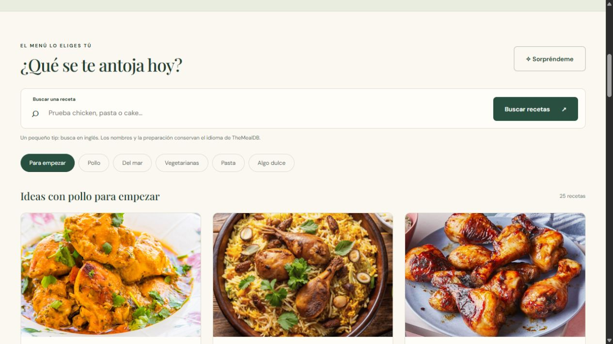

# MARecipes 🍴

Proyecto académico de Marjoxp: una página para descubrir recetas y consultar sus ingredientes y preparación mediante una API externa.

- Repositorio: https://github.com/Marjoxp/MARecipes
- Perfil: https://github.com/Marjoxp
- Plan de trabajo y requisitos: [docs/PLAN.md](docs/PLAN.md)
- Checklist de cumplimiento y pendientes: [docs/CHECKLIST.md](docs/CHECKLIST.md)
- Registro de IA: [docs/BITACORA.md](docs/BITACORA.md)



## API elegida

[TheMealDB](https://www.themealdb.com/api.php). Su documentación permite la clave pública de prueba `1` para desarrollo y uso educativo. No es una credencial privada. No requiere cuenta ni tarjeta para este proyecto educativo. Las recetas se muestran en el idioma original de la API, generalmente inglés; la interfaz es española. No se promete traducción automática.

Se utilizan búsqueda por nombre, filtro por categoría, consulta por identificador y receta aleatoria. El nivel gratuito no ofrece filtros por varios ingredientes ni el catálogo completo. Consultar las condiciones del proveedor antes de convertirlo en un producto público.

## Declaración de herramientas de IA

Se utilizó **Codex de OpenAI**, mediante esta conversación, para interpretar requisitos, comparar la API con su documentación oficial, generar código, preparar pruebas y redactar documentación. La IA no forma parte de la aplicación en ejecución: el requisito se cumple consumiendo una API de recetas.

Trabajo realizado sin ayuda de IA, confirmado por la autora: elección del tema de recetas y creación inicial del repositorio. El código producido en esta sesión tiene asistencia de IA. La autora deberá revisarlo, probarlo y poder explicarlo antes de entregarlo; otras aportaciones personales se documentarán cuando se realicen.

La autora también revisó la primera versión visual y pidió aprovechar el ancho de pantalla, alinear los textos y animar el plato; esos ajustes se implementaron con asistencia de IA y se registraron como un prompt real en la bitácora.

## Ejecución

Requiere Node.js 20 o posterior. No es necesario instalar paquetes ni configurar claves privadas.

```bash
git clone https://github.com/Marjoxp/MARecipes.git
cd MARecipes
npm start
```

Abrir http://127.0.0.1:5173. Detener el servidor con Ctrl+C. En PowerShell, si una política impide ejecutar `npm.ps1`, usar `npm.cmd start`. Es posible usar Live Server de VS Code como alternativa. No abrir `index.html` directamente mediante `file://`: la aplicación importa módulos JavaScript.

## Funciones

- Búsqueda por nombre en inglés, por ejemplo `chicken`, `pasta` o `cake`.
- Filtros por pollo, mariscos, recetas vegetarianas, pasta y postres.
- Detalle con ingredientes, medidas, preparación y enlaces del proveedor cuando existen.
- Acceso al detalle desde la imagen o desde “Ver receta”, también mediante teclado.
- Receta aleatoria con “Sorpréndeme”.
- Estados de carga, sin resultados, error de conexión, tiempo de espera, respuesta inválida y HTTP 429, con reintento.
- Diseño adaptable y diálogo que se puede cerrar con Escape.

La selección “Para empezar” consulta `chicken`; no representa el catálogo completo. Los resultados dependen de la disponibilidad y restricciones de TheMealDB. La búsqueda y las categorías son modos separados.

## Estructura y explicación

| Archivo | Responsabilidad |
| --- | --- |
| `index.html` | Estructura semántica, formulario, filtros y diálogo. |
| `styles.css` | Colores, tipografía, ilustración CSS y distribución adaptable. |
| `src/api.js` | Peticiones fetch, validación de JSON, errores y extracción de ingredientes. |
| `src/app.js` | Eventos, creación de tarjetas y detalle con textContent. |
| `scripts/serve.mjs` | Servidor local de desarrollo sin dependencias externas. |
| `tests/api.test.js` | Pruebas de la integración y casos de fallo mediante respuestas simuladas. |
| `docs/` | Plan, bitácora, resultados de verificación y guion de demostración. |

`fetch` pide JSON a la API; `await` espera la respuesta. `requestMeals` verifica el estado HTTP antes de leer JSON y convierte `meals: null` en una lista vacía. La interfaz crea nodos DOM y escribe datos con `textContent`. Se numeran las consultas para evitar que una respuesta vieja sobrescriba una búsqueda nueva. El detalle se consulta por ID porque los filtros no incluyen todos los ingredientes e instrucciones.

## Pruebas

```bash
npm test
npm run check
```

Las pruebas automatizadas no consumen la API real ni provocan límites del proveedor. Ver [docs/PRUEBAS.md](docs/PRUEBAS.md) para resultados y comprobaciones manuales. Guion para exposición: [docs/DEMOSTRACION.md](docs/DEMOSTRACION.md).

## Credenciales y publicación

La clave `1` es el valor público de demostración de TheMealDB, no un secreto. `.gitignore` excluye `.env` y sus variantes. Si se cambia a una API con credencial privada, debe almacenarse en un servidor mediante variables de entorno: ponerla en un `.env` que termine incluido en el frontend no la protege.

Este repositorio contiene una web estática; GitHub Pages puede servir `index.html`, `styles.css` y `src/` sin compilación. Publicar el repositorio no activa automáticamente GitHub Pages. Por ahora se entrega el código y la vista local; no se ha configurado alojamiento público adicional.

## Pendientes personales de entrega

Adjuntar evidencia de la segunda solicitud del Student Pack en revisión, avisar al docente, completar al menos cinco prompts reales con sus resultados y una reflexión personal, documentar un error de IA realmente detectado y realizar la demostración. La bitácora es un borrador y no se declara como requisito cumplido.
